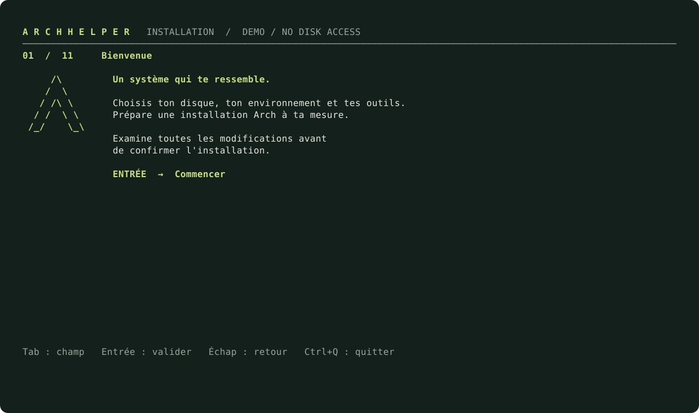
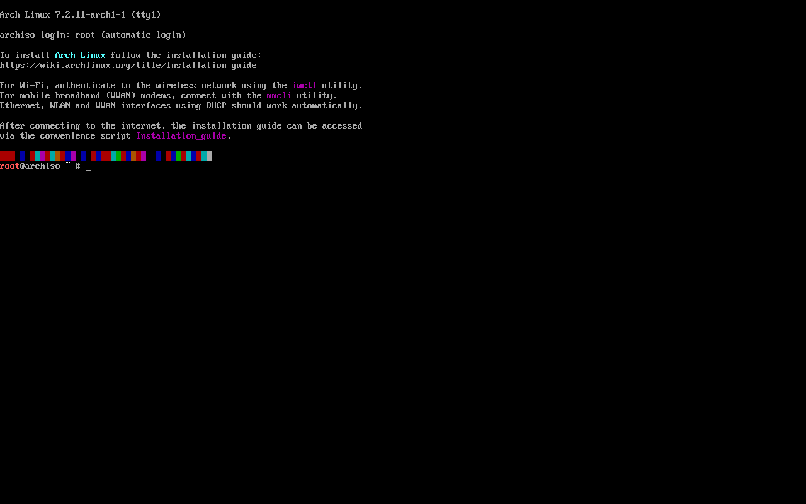
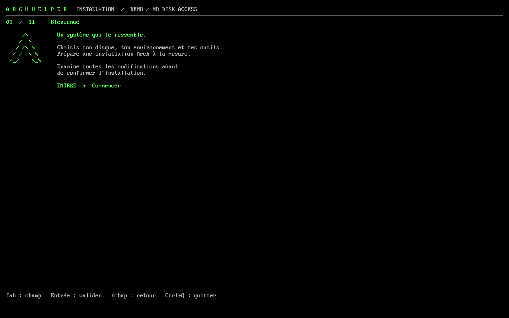
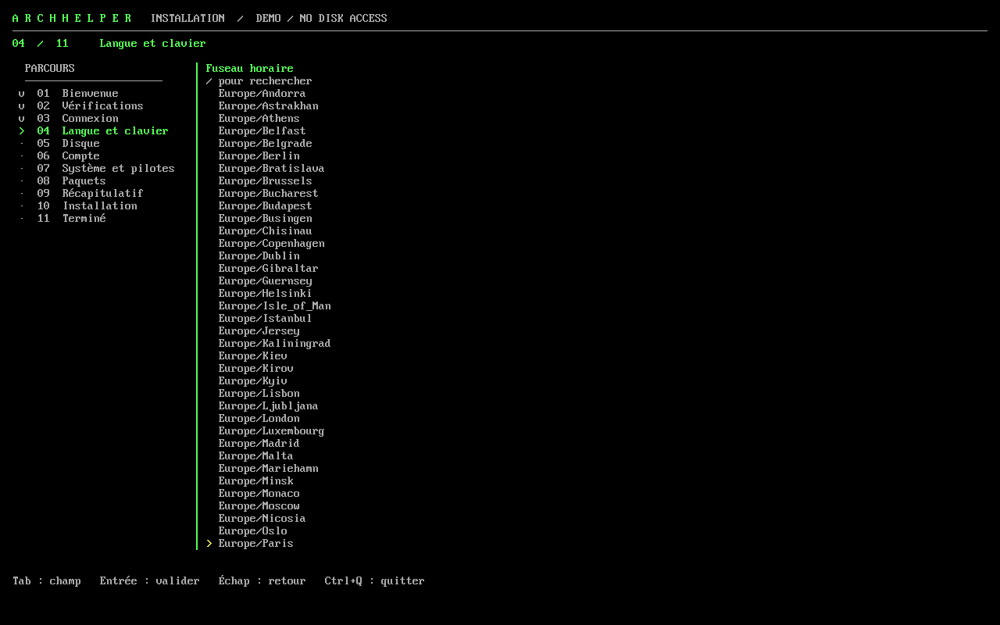
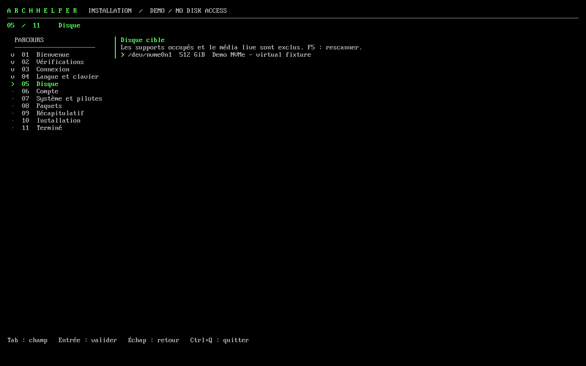
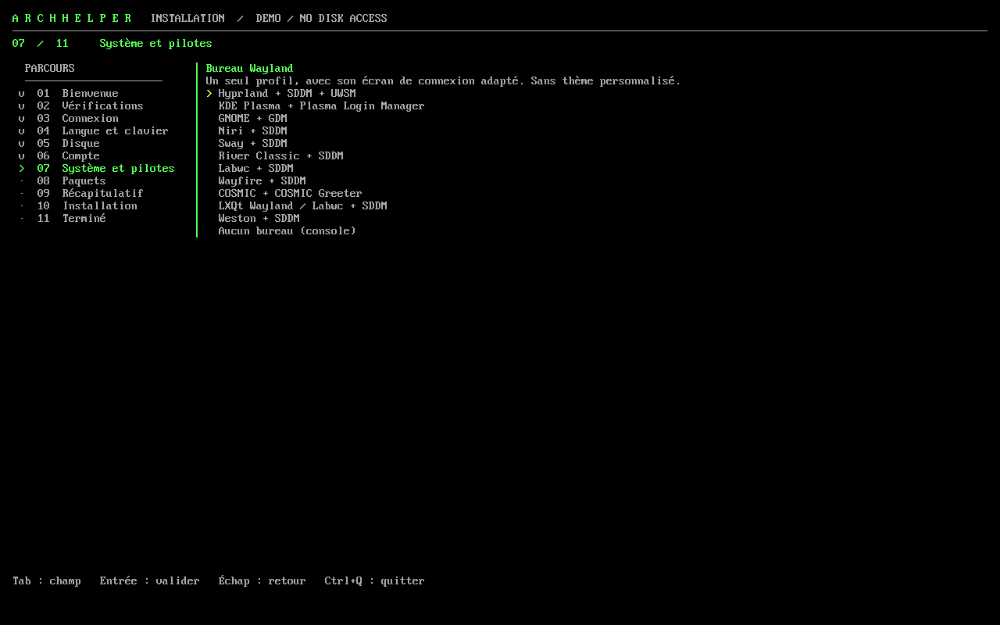
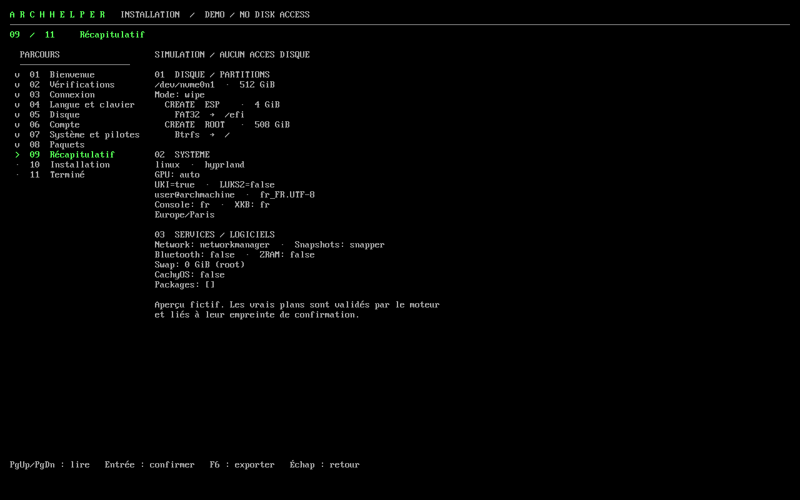
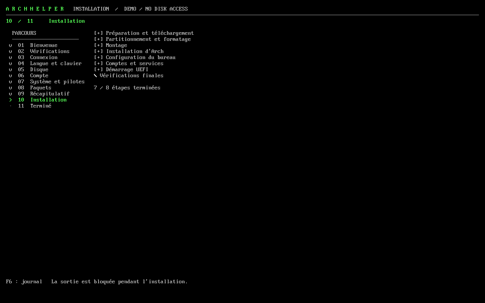
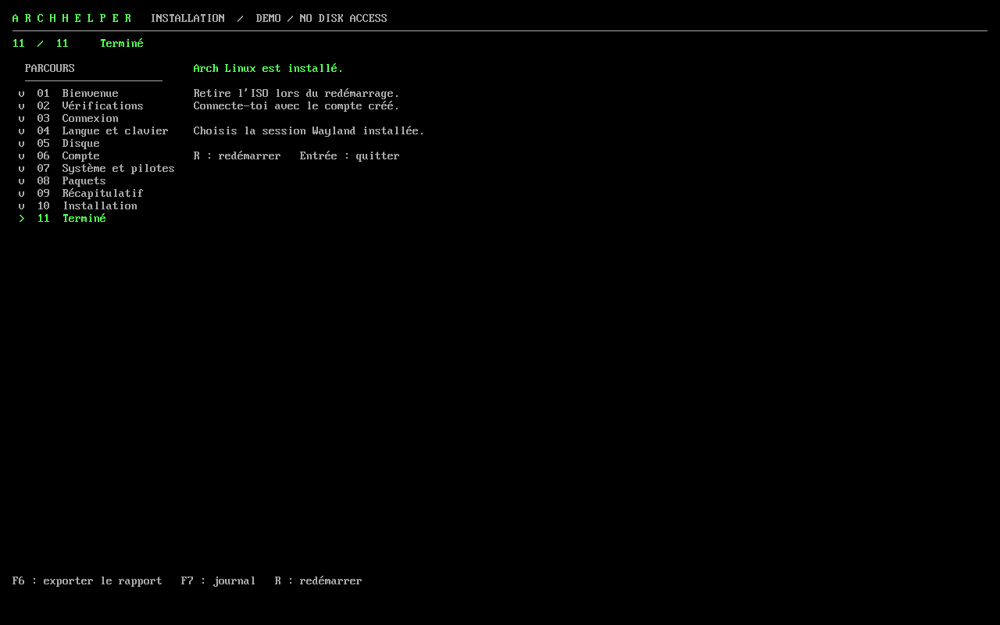

# ArchHelper — installateur pour l’ISO Arch officielle

Un assistant terminal plein écran pour installer **Arch Linux** et, au choix,
un environnement de bureau issu des dépôts actifs. Interface Go/Bubble Tea
et formulaires Huh ; moteur Python/archinstall.



## Captures en machine virtuelle

Session réelle dans QEMU/KVM avec UEFI : boot de l'ISO Arch officielle, montage
du support `ARCHHELPER`, puis démonstrateur — sans toucher au disque.

| Console live | Accueil |
|---|---|
|  |  |
| **Fuseau horaire** | **Disque cible** |
|  |  |
| **Bureau Wayland** | **Récapitulatif** |
|  |  |
| **Installation** | **Résultat du démonstrateur** |
|  |  |

Cette branche remplace la fabrication de l’ISO personnalisée. Elle ne modifie
pas `main`. Il s’agit d’une **préversion à qualifier en VM puis sur matériel**.

## Voir l’interface sans installer

Go 1.27.3 ou supérieur :

```sh
make tui
./dist/arch-install --demo
./dist/arch-install --demo --lang en
```

Le mode démo ne lance jamais le moteur Python et ne sonde ni ne modifie les
disques. Il simule le parcours et les huit phases d’installation.

L’interface fonctionne au clavier en 80×24 et ajoute une navigation latérale
sur grand terminal. Tab déplace le focus, Entrée valide, Échap revient en arrière.
F2 ouvre `iwctl` sur l’écran réseau ; F5 vérifie le réseau ou rescane les disques.
Le résumé défile avec PgUp/PgDn. F6 exporte le plan/rapport ou affiche le journal
pendant l’installation ; F7 affiche le journal après celle-ci. La sortie est
bloquée pendant l’exécution ; aucun redémarrage n’est automatique.

## Installer depuis le live

Prérequis : **ISO Arch officielle x86-64**, démarrage **UEFI**, **Secure Boot
désactivé**, Python **3.14**, archinstall **4.5**, Internet et disque cible dédié
aux essais. Prévoir 40 Gio ou davantage. L’installateur refuse une combinaison
non qualifiée plutôt que de remplacer les bibliothèques du live.

Construire le script autonome avec `make script`, puis transférer
`dist/install.sh` sur le live (par exemple avec une clé USB). Le fichier
`install.sh` à la racine du dépôt est un modèle et ne peut pas être exécuté
avant assemblage. Depuis le dossier contenant le script construit :

```sh
bash install.sh
```

Le lanceur vérifie le live et l’empreinte du contenu intégré, extrait ses fichiers
dans le live et lance le binaire précompilé. Aucun compilateur
ni accès au dépôt privé ne sont nécessaires sur la machine à installer. Sans
connexion, il propose de configurer le Wi-Fi avec `iwctl`. Internet reste nécessaire
pour préparer les paquets Arch. Avec `--demo`, aucune connexion n’est demandée.
Le répertoire temporaire du lanceur est supprimé à sa sortie ; le moteur prépare
son propre cache de paquets dans le live avant les écritures sur disque.

## Parcours et protections

Bienvenue → vérifications → réseau → langue/clavier → disque → compte → options
système/pilotes → paquets supplémentaires → récapitulatif → installation → résultat.

| Mode disque | Effet |
|---|---|
| Effacement | Nouvelle GPT, ESP de 4 Gio et racine Btrfs ; tout le disque est effacé après confirmation |
| Espace libre | Nouvelles partitions uniquement dans l’espace non alloué ; aucune réduction automatique |
| Manuel | Conserver, créer, formater ou supprimer explicitement ; ESP existante réutilisable sans formatage |

Le moteur construit le résumé et la confirmation liée au disque et à l’empreinte
du plan. Les disques montés, le média live et les volumes actifs sont protégés.
L’identité et la géométrie sont relues avant écriture.

La liste des paquets supplémentaires provient des dépôts actifs du live. Le
moteur résout la transaction complète avant confirmation, puis télécharge et
vérifie les signatures des paquets avant formatage. La configuration pacman
résolue et le trousseau de confiance du live sont copiés vers la cible : les
fichiers Include utilisés par les dépôts sont intégrés à la configuration.
Le dépôt CachyOS est facultatif. Son activation importe sa clé officielle dans
le live et installe son trousseau après vérification de la signature ; le noyau
`linux-cachyos` devient alors sélectionnable et le dépôt Arch multilib est activé
si nécessaire. Une installation avec ce dépôt et son noyau a été testée en VM.

Défauts : `linux`, systemd-boot, Btrfs et sous-volumes, UKI/Plymouth actifs,
LUKS2 facultatif, Snapper/snap-pac, NetworkManager, pare-feu entrant fermé et SSH
désactivé. Le Wi-Fi du live n’est pas copié avec ses secrets : reconnecter le
réseau après le premier démarrage.

La langue de l’interface et celle du système sont indépendantes. Les claviers
console et graphique sont choisis séparément ; vérifier leur correspondance avant
de poursuivre. Le clavier console est appliqué au live dès sa validation, avant
la saisie des mots de passe. Le compte root peut être activé en plus d’un utilisateur ou être
le seul compte avec le profil console.

Bluetooth, ZRAM, le réseau et les instantanés sont configurables. Certains
bureaux exigent des paquets Bluetooth ou NetworkManager : leurs services restent
masqués lorsqu’ils ne sont pas choisis. Le swap sur disque peut résider dans la
racine ou `/home` ; une partition `/home` séparée n’est pas chiffrée par le LUKS
de la racine. Une partition `/home` conservée ne peut pas accueillir ce swap.
Timeshift est configuré pour des instantanés quotidiens de la racine Btrfs,
avec cinq conservés et un contrôle horaire de sa planification.

CPU/GPU détectés : microcode Intel/AMD, Mesa, profil VM séparé, Nouveau ou NVIDIA
Turing et ultérieur via table PCI officielle épinglée. Le profil NVIDIA utilise
des modules précompilés pour `linux` et `linux-lts`, et DKMS avec les en-têtes
pour les autres noyaux, ainsi que les composants utilisateurs correspondants.
Sur hybride, le GPU intégré reste prioritaire ; `prime-run <application>` permet
le lancement sur NVIDIA. Les modèles anciens ou inconnus sont refusés pour le
profil NVIDIA open, mais Nouveau reste sélectionnable. Avec CachyOS, le pilote
propriétaire NVIDIA 580xx est proposé pour les modèles de la liste NVIDIA incluse,
en tenant compte des identifiants de sous-système lorsque nécessaire.

Les secrets passent par un tube privé, jamais par les arguments ou le plan.
Les rapports sont sous `/var/log/v8-installer/<session>/`, privés et filtrés.
Les exporter avant d’éteindre le live. Une interruption exige un nouveau scan et
un nouveau plan ; aucune reprise automatique du formatage n’est proposée.

## Construire les releases

Le constructeur Linux x86-64/QEMU/KVM existant reste isolé, avec le dépôt monté
en lecture seule et seulement `dist/` partagé en écriture. Lancer sans sudo :

```sh
./v8 check
./v8 build
```

Prévoir 16 Gio de RAM et 45 Gio libres sur l’hôte. `./v8 clean` nettoie le
constructeur, `./v8 stop` l’arrête. Le workflow manuel **Build installer preview**
construit également les archives dans un conteneur Arch jetable.

La construction produit le script autonome `install.sh`, une archive des sources
avec bibliothèques Go vendoriées, SHA256SUMS, provenance et résultats de tests.
Elle ne construit plus d’ISO. Les fichiers construits sont destinés au transfert
local et aux essais ; aucun script ne crée de dépôt ni ne publie de release.

Conserver les empreintes provenant de la construction lors du transfert. Les
paquets des dépôts gardent leurs signatures obligatoires.

## Développement et validation

```sh
make test-python  # pytest + dépendances Arch, sans opérations de partitionnement
make test-go     # parcours, géométrie, secrets, export et dimensions d’écran
```

[Architecture et protocole](installer/README.md) ·
[Comparatif des outils](docs/OUTILS_INSTALLATEUR.md) ·
[Qualification ISO/VM/matériel](docs/VALIDATION_ARCHISO.md) ·
[Résultats effectivement obtenus](VALIDATION.md)

BIOS, ARM, Secure Boot/TPM2, NVIDIA ancien, AUR et bootloaders alternatifs restent
hors de cette version. Les documents d’audit historiques dans `docs/` décrivent
la préversion précédente ; ils ne constituent pas des résultats pour celle-ci.

## Licences

Installateur et intégration : MIT ([LICENSE](LICENSE)). Omarchy et
OmaControl conservent leurs licences ; Quickshell reste LGPL-3.0-only et OWE MIT.
Les archives publiques comprennent les sources correspondantes et leurs licences.

Pour reproduire les captures du parcours terminal (dépendance de développement
`pyte==0.8.2`) :

```sh
python scripts/test-terminal.py --binary dist/arch-install --output dist/terminal-fr
python scripts/test-terminal.py --binary dist/arch-install --output dist/terminal-en --lang en --width 80 --height 24 --console --luks
```

Un scénario VHS est également fourni dans `installer/tui/demo.tape`.
