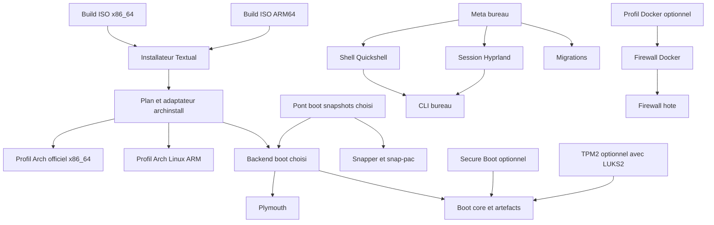

# Distribution Arch Omarchy-like v8 — audit et architecture technique

Statut : proposition d’architecture fondée sur une inspection statique réelle ; aucune distribution n’a été construite ou installée. Date de consultation : 23 octobre 2026, Europe/Paris. « v8 » est ici le nom de travail du projet, pas une version d’Omarchy ou d’Arch.

Décision de première release, ajoutée après l’audit initial : conserver le runtime **Quickshell patché comme dans Omarchy**, construit et signé par le projet, avec Qt6 upstream. Le correctif inspecté ne modifie pas Qt lui-même. Le port vers un Quickshell non patché est différé. La [passe complète sur les helpers](HELPERS_FIRST_RELEASE.md) et le [PKGBUILD de runtime proposé](first-release-runtime/PKGBUILD) complètent cette spécification ; ce PKGBUILD reste non compilé.

## 1. Conclusion et périmètre de preuve

**Le fork demandé est possible, mais reprendre les deux paquets Omarchy en changeant leurs noms ne respecte pas les contraintes.** Le shell Quickshell est dans le dépôt principal ; l’ISO et les recettes de paquets sont dans deux autres dépôts. Le runtime tire le boot Limine sur x86-64, les defaults regroupent fichiers système et configuration utilisateur, et les outils de mise à jour pilotent les dépôts du fournisseur. Il faut conserver le bureau et ses contrats utiles, puis remplacer le couplage installation–boot–distribution.

Le tag **`v4.5.0-rc1` existe exactement**, dans `omacom/omarchy`, au commit **`03ff1eff3812933f7088484533784d2f63eaf19a`**. Aucune substitution par une autre RC. Le namespace historique `basecamp` ne doit pas servir de référence canonique. La [release correspondante](https://github.com/omacom/omarchy/releases/tag/v4.5.0-rc1) publie déjà des ISO x86_64 et aarch64. L’ARM64, Quickshell, UFW/Docker et les migrations ne sont donc pas des fonctionnalités entièrement absentes de cette RC.

Le tag ne fige pas, à lui seul, tous les sous-projets et tous les paquets d’une ISO publiée. Les références secondaires ont été résolues explicitement :

| Source | Référence inspectée | Nature et limite |
|---|---|---|
| O — `omacom/omarchy` | `03ff1eff3812933f7088484533784d2f63eaf19a` | Tag exact `v4.5.0-rc1` ; 5 181 fichiers suivis |
| I — `omacom/omarchy-iso` | `c0c64fe14a4e5d0c6569413d2d57460b96a2b56e` | Commit du 20 octobre à 08:31:46 UTC, dernier trouvé sur la branche par défaut avant le seuil de publication 08:54 UTC ; 138 chemins dont un gitlink ; aucun tag `v4.5*` observé |
| P — `omacom/omarchy-pkgs`, branche RC | `bed2ea5a48400c02228c86dd4da9bc75487a24ee` | Commit « Release omarchy 4.5.0rc1 » ; les deux PKGBUILD épinglent bien O ; 2 470 fichiers suivis ; aucun tag `v4.5*` observé |
| PS — recettes, branche par défaut | `5db964323aae25447ce01d83bf471ec84098dfcd` | Contre-vérification : `omarchy` et `omarchy-settings` épinglent encore `v4.0.6`, commit `237f1b…`. Ce n’est pas la recette de la RC |
| AI — Archiso officiel | `424e78130db2af6c1ceb55b442d7914b1109ff2b` | Sous-module réellement récupéré au gitlink de I ; pas une branche `main` flottante |
| A — archinstall officiel | `78982a624824aa415f59bf88c515676a589e3c55` | Tag `4.5`, sans préfixe `v` ; API disponible et dépendance Textual vérifiées |
| Q — Quickshell | `2b4501a282689792b62e94f3fb30d8f512324fe6` | Commit de la recette RC ; le patch Omarchy est inspecté séparément dans P |
| F — ufw-docker | `78366b6afe6e566cd53f7e55341889c2e3c863e7` | Tag `251123`, conforme à la recette RC |
| B — LazyWare/systemd-boot-snapshots | `d9d1657b77844dfdb995d5f3f438261be1494045` | HEAD consulté, recette 0.2.0 ; candidat communautaire seulement |
| R — paru | `7830fac148f8cd2143307386ead67d7ffd2efa33` | HEAD consulté pour les options de revue ; version de livraison v8 à verrouiller séparément |
| S — snap-pac | `6cfaa46fff6c687ad1bbb84c457e5bb6126acd85` | Tag `3.0.1` ; hooks pre/post lus |

Les neuf recettes critiques comparées entre PS et P — Quickshell, Hyprland, Aquamarine, titlebars, OWE, owe-lockfeed, ufw-docker, limine-mkinitcpio-hook et limine-snapper-sync — ont des PKGBUILD identiques dans ces deux instantanés. Les pins des paquets `omarchy`/`omarchy-settings` diffèrent bien. Cela ne prouve pas l’identité de tous les paquets binaires publiés.

**Anomalie de version :** `O:version` contient `4.0.0.alpha` même au tag demandé. Ne pas dériver la provenance du fork de ce seul fichier. Les valeurs faisant foi pour cette étude sont le tag, le commit et les pins des recettes RC.

L’audit détaillé est dans [AUDIT_FICHIERS_CLES.md](AUDIT_FICHIERS_CLES.md). Ses identifiants A01–A77 renvoient à des permaliens avec numéros de ligne ; [preuves.json](preuves.json) conserve des extraits et empreintes. [sources.lock.json](sources.lock.json) fige les sources, dates et empreintes des index de paquets.

**Couverture :** inventaire complet des chemins de O, I et P, soit 7 789 lignes dans [inventaire-sources.csv](inventaire-sources.csv), et lecture ciblée de 77 fichiers clés. Les milliers de traductions, assets et tests ont une décision de famille, explicitement marquée comme telle. Il ne s’agit ni d’une revue ligne par ligne de tous les fichiers ni d’un audit de sécurité exhaustif. Aucun script amont, PKGBUILD, installateur, service ou test amont n’a été exécuté. Les signatures Git et des index de paquets n’ont pas été vérifiées localement ; les index servent de preuve de disponibilité, pas d’entrées de build de confiance. La provenance exacte du binaire ISO vers le commit I n’est pas attestée ici.

## 2. Exigences retenues et choix d’architecture

| ID | Exigence ferme | Décision technique / critère |
|---|---|---|
| R01 | Aucun dépôt Omarchy | Ni `[omarchy]`, ni clé Omarchy, ni serveur `pkgs`, `mirror`, `arm-mirror`, stable/RC/edge Omarchy dans les installations et builds v8 |
| R02 | Arch officiel x86-64 | Base `core`/`extra` ; `multilib` uniquement si choisi ; exception de première release explicite : paquet `v8-quickshell` fournissant le runtime patché, Qt6 restant upstream |
| R03 | ARM64, source séparée | Arch Linux ARM pour userspace et paquets ARM ; profil UEFI générique puis profils matériels distincts ; aucun mélange avec les dépôts x86-64 |
| R04 | systemd-boot par défaut | Défaut UEFI ; backend GRUB et backend Limine installables au choix ; capacités vérifiées par combinaison |
| R05 | `linux` par défaut, pas de LTS de secours | Sur x86-64 : exactement `linux` par défaut. `linux-lts`, `linux-zen`, `linux-hardened` sont des choix explicites, pas des ajouts automatiques. ARM : `linux-aarch64` pour le profil UEFI générique |
| R06 | Secure Boot optionnel | Désactivé dans le choix initial ; activable avec UKI signé et clés locales, sur matériel capable et chemin certifié |
| R07 | LUKS2 optionnel | Écran explicite avec ou sans chiffrement ; pas de conversion silencieuse ; ESP non chiffrée |
| R08 | TPM2 optionnel matériellement | Proposé seulement avec LUKS2 et TPM2 utilisable ; le chemin certifié initial exige UKI ; récupération par passphrase toujours conservée ; politique PCR explicitée |
| R09 | Plymouth actif | Installé et activé dans le profil par défaut, avec ou sans LUKS2 ; option de désactivation en mode avancé et retour texte fonctionnel |
| R10 | Trois modes de partitionnement | Effacer un disque ; installer à côté dans l’espace libre ; partitionnement manuel complet. Même plan validé et même moteur d’exécution |
| R11 | Btrfs + Snapper/snap-pac et snapshots bootables | Snapshots transactionnels distincts des générations bootables ; cohérence noyau/modules/initramfs/UKI testée ; aucun raccourci « entrée menu = snapshot bootable » |
| R12 | Pare-feu et ports Docker protégés | Entrant refusé ; exposition Docker depuis LAN et WAN refusée sans règle explicite ; IPv4/IPv6 ; backend connu |
| R13 | SSH off | Live et cible : aucun serveur SSH actif par défaut, ni activation par simple présence d’une clé ; client autorisé |
| R14 | AUR via paru avec revue PKGBUILD | Revue interactive activée pour ajout et mise à jour ; aucune réutilisation du flux yay `--noconfirm` |
| R15 | Shell Quickshell/Hyprland | Fork du shell RC sur `v8-quickshell` patché pour la première release ; Qt6 upstream ; boot, installateur, AUR et serveur SSH indépendants |
| R16 | Migration versionnée du bureau | Versions de release et de schéma séparées ; migrations système/utilisateur séparées, reprises, sauvegardées et traçables |

Le préfixe `v8-` des paquets est provisoire. Un **dépôt propre au projet**, signé et limité aux paquets v8 et aux rares composants non officiels retenus, est proposé pour livrer les mises à jour. Cela respecte R01 : ce n’est ni une dépendance ni un miroir du dépôt Omarchy. Sans service de dépôt propre, les mêmes paquets peuvent être livrés par archives signées et un dépôt local à l’ISO, mais il faut alors définir un autre canal de mise à jour ; ce n’est pas gratuit.

La base Arch reste rolling. Une version « bureau 8.1 » n’est pas une version figée d’Arch. Ne pas geler Hyprland ou Qt isolément sur un système dont les bibliothèques continuent à évoluer : tester et adapter le bureau, ou publier un échec de compatibilité visible. Aucun mécanisme d’upgrade partiel silencieux.

## 3. Audit par répertoire

Les chemins de cette section sont relatifs à O, sauf préfixe I ou P. « Suppression » signifie exclusion du produit v8 ou du profil par défaut, jamais suppression de fichiers sur cette machine. La décision fine d’un fichier dans l’annexe prime sur la décision générale de sa famille.

| Répertoire / ensemble | Volume O | Classe principale | Reprise et transformation attendues |
|---|---:|---|---|
| `shell/` | 249 | Adaptation | Garder hôte, plugins, composants communs et IPC ; adapter imports Qt, racines, branding, catalogue et dépendances optionnelles. A04–A09 |
| `bin/` | 536 | Adaptation sélective | Garder les helpers réellement appelés ; remplacer gestion AUR, mise à jour, boot, restauration, reset et migrations. A31–A38 |
| `config/` | 48 | Adaptation | Defaults utilisateur initiaux ; conserver overrides locaux. Ne pas resynchroniser avec une copie aveugle de `/etc/skel`. A10, A37 |
| `default/hypr/` | inclus dans 446 | Adaptation | Bootstrap Lua, raccourcis, workspaces et thèmes ; découpler autostart, titre des fenêtres et matériel. A11–A12 |
| `default/pacman/` | inclus | Remplacement | Arch x86-64 ou ALARM ; aucune dépendance aux canaux du fournisseur. A13–A14 |
| `default/limine/` | inclus | Suppression du défaut | Sources éventuelles du seul backend Limine ; ne pas les installer avec le shell |
| `default/snapper/` | inclus | Adaptation | Politique root, rétention, quotas ; Snapper ne doit pas dépendre du bootloader. A20 |
| `default/plymouth/`, `default/sddm/` | inclus | Adaptation | Thèmes séparés de leurs moteurs ; les mises à jour ne forcent pas un autologin |
| `default/themed/`, `default/i18n/`, fonts, GTK, terminaux | inclus | Adaptation | Templates et traductions réutilisables ; vérifier références à commandes, apps, glyphes et marques |
| `default/libalpm/` | inclus | Remplacement partiel | Retirer le garde qui bloque `pacman -Syu` au profit du fournisseur ; conserver l’idée d’un pause/reload sûr Hyprland si nécessaire ; nouveaux hooks boot/snapshots idempotents |
| autres `default/` | inclus | Adaptation / sélection | Profils audio, environnement, UWSM et applications ; mise, outils agents et services commerciaux deviennent optionnels |
| `etc/` | 54 | Remplacement partiel | Drop-ins système à répartir par propriétaire ; remplacer mkinitcpio/boot ; ne pas écraser NSS/PAM/sudoers en bloc. A15–A19 |
| `install/config/` | inclus dans 118 | Adaptation / remplacement | Conserver activation hors ligne et choix sans groupe Docker ; refaire firewall, Snapper, sélection services. A24–A29 |
| `install/hardware/` | inclus | Adaptation ciblée | Extraire corrections par matériel avec prédicats ; transférer paramètres Limine vers contrat boot ; aucun quirk sans appareil ou test associé |
| `install/user/` | inclus | Adaptation | Finalisation minimale par utilisateur ; profil développeur et agents en option ; journal de first-run sans accès root implicite |
| `install/provisioning/` | inclus | Suppression du flux public initial | Provisionnement OEM et clés LUKS temporaires hors installation grand public ; images OEM pourront avoir un contrat séparé. A30 |
| `install/*.packages` | inclus | Remplacement | Catalogues par architecture, plateforme et fonctionnalités ; pas une grosse liste additive identique pour tous. A21–A23 |
| `migrations/` | 204 | Suppression de l’exécution v8 | Garder comme historique de problèmes et exemples ; aucune migration Omarchy historique exécutée sur une v8 neuve |
| `themes/` | 276 | Adaptation | Paquet indépendant, palette de secours dans le shell ; intros vidéo optionnelles ; attribution des assets à vérifier |
| `applications/` | 33 | Adaptation / suppression sélective | Garder lanceurs nécessaires ; retirer catalogue préinstallé de webapps et services du fournisseur ; icônes gérées par paquet |
| `test/` | 575 | Adaptation | Réutiliser fixtures, budgets idle et tests de contrats ; supprimer hypothèses Omarchy ; acceptance seulement dans VMs jetables |
| `docs/` | 14 | Adaptation | Documentation architecturale utile mais vérifier contre le code ; certaines sections d’update sont contradictoires |
| `manual/` | 2 594 | Adaptation | Réécrire seulement parcours réellement livrés ; traductions ne constituent pas une preuve de fonctionnalités disponibles |
| `agents/`, `scripts/` | 9 | Adaptation | Guides de contribution et synchronisation i18n ; pas de runtime utilisateur |
| `.github/`, configs de développement | divers | Adaptation / reprise | Remplacer CI, release, domaines et secrets du fournisseur ; conserver conventions utiles |
| `plans/`, `.greptile/` | 8 | Suppression du produit | Ne pas traiter des intentions amont comme des fonctionnalités livrées |
| logos, icônes, `version`, README | divers | Remplacement | Identité projet, version de paquet, références commit ; conserver les notices applicables |

### 3.1 Installateur et ISO, dépôt I

| Chemins | Classe | Constat et destination |
|---|---|---|
| `configs/airootfs/root/configurator` | Remplacement | Assistant Bash/Gum avec modes disque entier et espace libre ; `cfdisk` aide à libérer de l’espace mais ne constitue pas le troisième mode manuel intégré. `v8-installer` Textual. A53 |
| `configs/airootfs/usr/share/omarchy-iso/disk-partitioning.sh` | Adaptation des tests et invariants | Relire le numéro réellement attribué, attendre udev et exclure le média ; conserver ces invariants sans maintenir deux moteurs de formatage. A54 |
| même racine, `orchestrator/{main,phases,archinstall_adapter}.py` | Adaptation | Ordre explicite, journal atomique et mur de compatibilité archinstall sont utiles. Les commentaires sur du « patching » ne suffisent pas à prouver qu’un fork archinstall est requis : le wrapper lu ne patch pas la bibliothèque. A55–A58 |
| `orchestrator/context.py` | Remplacement | Objet `InstallPlan` propre à v8, validation préalable et secrets séparés du JSON |
| `orchestrator/phases_impl.py` | Remplacement / extraction | Boot Limine installé directement, hook dédié, UKI, Snapper et autologin liés au chiffrement ; séparer backends et politiques. SSH possible avec clés autoinstall : décision explicite nécessaire. A59 |
| `builder/build-iso.sh`, `configs/pacman-*` | Remplacement | Injectent dépôts et keyring Omarchy ; live x86-64 configuré autour de `linux-t2`, ARM autour de `linux-omarchy`. Le live v8 part d’Arch officiel `linux` ou du profil ARM choisi. A60 |
| `bin/omarchy-iso-make`, `builder/build-omarchy-packages.sh` | Adaptation | Conserver build local isolé et artefacts vérifiables ; figer images de build, sources et paquets ; aucun build direct sur l’hôte utilisateur. A61 |
| `builder/archiso-v87-aarch64-*.patch`, `archiso` | Adaptation | Archiso ARM n’est pas un simple changement de nom d’architecture ; patches dépendants du gitlink, boot EFI/GRUB et modules spécifiques. A62–A64 |
| `builder/qualcomm/`, `arm64-kernel-image.sh`, `aarch64-package-filter.sh` | Adaptation différée par plateforme | Firmware et DTB sont un chantier matériel ; ne pas promettre support Snapdragon/N1x en remplaçant simplement le noyau fournisseur |
| `builder/n1x-dev-ssh/`, option `--dev-ssh` | Suppression ISO publique | Aucun SSH root de développement embarqué dans les sorties publiques |
| `configs/efiboot/`, `configs/grub/`, `configs/syslinux/`, `profiledef.sh` | Adaptation | Boot du média distinct du boot installé ; UEFI d’abord, support BIOS seulement dans un profil testé |
| `test/`, `manifests/`, workflows | Adaptation | Réutiliser tests de numérotation, protection partitions, boot, SSH et installation ; refaire attentes paquets et identité |

**SSH dans le live :** le sous-module Archiso `configs/releng/airootfs/etc/systemd/system/multi-user.target.wants/sshd.service` active le service dans son profil. La v8 doit retirer ce lien de l’arborescence de build et vérifier l’état au démarrage. L’absence d’activation dans le finaliseur cible ne suffit pas. A65.

### 3.2 Paquets et sous-projets, dépôt P

| Recette / projet | Classe | Dépendances et raison |
|---|---|---|
| `pkgbuilds/omarchy/PKGBUILD` | Remplacement | Agrège runtime, migrations, install et shell ; dépend exactement de settings et du boot Limine x86-64. Découper, ne pas reprendre le graphe. A39 |
| `pkgbuilds/omarchy-settings/{PKGBUILD,omarchy-settings.install}` | Remplacement | `/etc/skel`, `/etc`, boot, SDDM, Plymouth, fonts et debug ; le scriptlet écrase plusieurs fichiers upstream avec `cp -f` à chaque upgrade. Drop-ins et `backup=()` à la place. A40–A41 |
| `pkgbuilds/quickshell/` | Adaptation du paquet ; reprise du patch pour R1 | Version `0.3.2.r7.g2b4501a`, patch `load_qtquick_611.patch`, contrôle après Qt. Première release : conserver ce patch du loader Quickshell et le pragma du shell ; construire le runtime dans le dépôt propre v8. Le port vers un runtime non patché est différé. Qt lui-même reste upstream. A42–A44 |
| `pkgbuilds/hyprland/`, `aquamarine/` | Paquets officiels préférés | Les recettes fournisseur incluent des adaptations dont la portée varie par architecture. L’égalité de numéro de version ne prouve pas l’égalité ABI ou de build |
| `pkgbuilds/omarchy-hyprland-titlebars/` | Adaptation optionnelle | `titlebars.so` compilé pour Hyprland 0.56.2 ; couplage build/ABI. Le code Lua teste déjà l’absence du fichier. A45 |
| `pkgbuilds/owe/`, `owe-lockfeed/` | Adaptation optionnelle | Moteur Wayland/mpv/ffmpeg et module QML Qt natif ; inclus dans l’assemblage R1 pour préserver le first-run RC. Leur retrait devient une option après adaptation des appels unités/hooks/thème. A46–A47 |
| `pkgbuilds/ufw-docker/`, upstream `ufw-docker` | Remplacement de politique | Le script upstream produit des `RETURN` pour les sources privées par défaut. Refaire le contrat LAN/WAN au lieu de déclarer le résultat protégé par la seule présence du paquet. A48, A71 |
| `pkgbuilds/limine-mkinitcpio-hook/` | Adaptation optionnelle | 1.40.0, amont `gitlab.com/Zesko/limine-entry-tool` ; seulement backend Limine. Implémentation amont complète non auditée ici. A49 |
| `pkgbuilds/limine-snapper-sync/` | Adaptation optionnelle | 1.32.1, amont GitLab Zesko ; restauration et génération propres à Limine, pas réutilisables telles quelles pour systemd-boot. A50 |
| `pkgbuilds/omarchy-keyring/` | Suppression | Remplacer par confiance propre au projet ; clés Arch/ALARM distinctes. A51 |
| `pkgbuilds/omarchy-nvim/` | Suppression du socle | LazyVim préconstruit et plugins ; aucun lien nécessaire avec shell ou boot. Neovim officiel dans l’assemblage de première release pour le fallback des helpers ; la configuration LazyVim reste facultative. A52 |
| `pkgbuilds/linux-omarchy*`, `linux-t2`, paquets matériels | Suppression du défaut / adaptation ciblée | Ne pas reconstruire un kernel fournisseur pour le socle ; pilote et kernel propres au matériel seulement quand sélectionnés |
| `bin/`, `ci/`, `build/`, `helpers/`, workflows P | Remplacement / adaptation CI | Publier seulement le périmètre v8 ; pas de promotion des anneaux Omarchy ni réutilisation des clés et buckets |

### 3.3 Dépendances constatées, pas seulement des noms de paquets

Le shell et les configs Hyprland référencent littéralement **146 commandes existantes de `bin/`**. La liste est dans [couplages-commandes-bureau.csv](couplages-commandes-bureau.csv), avec fichiers appelants. C’est un minimum : les noms construits dynamiquement, menus, scripts indirects et services D-Bus nécessitent une vérification complémentaire en VM.

Pour la première release, conserver les commandes `omarchy-*`, les IDs `omarchy.*`, la racine interne `/usr/share/omarchy`, ses symlinks de binaires et les répertoires utilisateur `.config/omarchy` et `.local/state/omarchy`, tous possédés ou initialisés par les paquets v8. Le renommage global est différé à une migration. Modifier seulement `OMARCHY_PATH` déclencherait des branches de développement dans plusieurs helpers. L’environnement de production doit donc utiliser une racine fixe, sans override de checkout utilisateur ; les commandes privilégiées sélectionnent uniquement le code empaqueté de confiance. Cela ne réintroduit aucun dépôt, clé ou paquet Omarchy. La co-installation des paquets amont possédant les mêmes chemins n’est pas prise en charge.

La passe complémentaire classe les 536 helpers et ajoute les gardes du menu, le dispatch dynamique, les unités utilisateur et les assets partagés : [HELPERS_FIRST_RELEASE.md](HELPERS_FIRST_RELEASE.md). Les décisions `module` ne permettent pas de supprimer un helper encore appelé inconditionnellement par le socle.

## 4. Disponibilité des paquets : résultat de consultation

Les bases `core`, `extra` et `multilib` x86-64 ont été téléchargées en métadonnées, ainsi que `core` et `extra` ALARM aarch64. Les 237 noms distincts des manifestes Omarchy ont été comparés, complétés par les choix v8, soit **254 entrées** dans [matrice-paquets-amont.csv](matrice-paquets-amont.csv). Les alias `provides` sont signalés ; par exemple `nvim` peut être résolu vers `neovim`. « Absent nom exact » n’équivaut pas à « logiciel introuvable » et ne prouve aucune disponibilité AUR.

| Composant | Arch x86-64 observé | ALARM aarch64 observé | Conséquence v8 |
|---|---|---|---|
| archinstall | 4.5-1 | 4.5-1 | Même version possible dans les ISO ; figer précisément l’API utilisée |
| Quickshell | 0.3.2-1 | 0.3.2-1 | Runtime officiel disponible ; première release sur runtime patché v8 à compiler et tester |
| Hyprland | 0.56.2-4 | 0.56.2-4 | Lua présente dans cette génération ; plugins natifs à reconstruire si retenus |
| kernel défaut | `linux` 7.2.11.arch1-1 | `linux-aarch64` 7.2.11-1 | Noms et chaînes de boot différents |
| Snapper | 0.13.2-1 | 0.13.2-1 | Socle snapshots disponible |
| snap-pac | 3.0.1-3 | 3.0.1-3 | Pre/post ALPM disponible, ne crée pas seul un boot de snapshot |
| systemd-ukify | 262.1-1 | 262.1-1 | Outil UKI disponible ; ne suffit pas à certifier le firmware |
| sbctl | 0.18-2 | 0.18-2 | Outil disponible, enrôlement matériel à tester |
| UFW | 0.36.2-7 | 0.36.2-7 | Politique hôte réutilisable |
| paru / ufw-docker | Absents des index consultés | Absents des index consultés | Construire paru depuis recette revue ; garde Docker spécifique au projet |

Ces versions sont des observations au jour d’audit, pas celles garanties dans les ISO Omarchy du 20 octobre, ni des pins éternels. Le répartiteur HTTPS `mirror.archlinuxarm.org` a échoué sur son certificat lors de cette consultation ; la lecture a abouti via `de3.mirror.archlinuxarm.org` sans désactiver TLS. Les empreintes des bases effectivement lues sont conservées. Certaines pages web ALARM étaient en retard sur les index : l’index lu prévaut pour cette matrice, sans valider les signatures des paquets.

[Arch décrit sa distribution officielle comme x86-64](https://archlinux.org/about/). [Arch Linux ARM est un port distinct](https://archlinuxarm.org/about) ; son [profil générique](https://archlinuxarm.org/platforms/armv8/generic) demande explicitement de préparer le boot pour sa machine. Une ISO ARM UEFI ne devient donc pas un installateur universel Raspberry Pi, Apple Silicon et Snapdragon.

## 5. Découpage en paquets et responsabilités

Un monorepo v8 suffit au départ. L’indépendance recherchée est celle des paquets, contrats et cycles de livraison ; multiplier les dépôts Git n’apporte rien à ce stade. Les deux ISO sont des **sorties de build**, pas des paquets runtime installés sur le disque cible.

| Unité | Type et contenu | Dépendances fortes | Dépendances conditionnelles / limites |
|---|---|---|---|
| `v8-quickshell` | Runtime natif Quickshell avec patch loader RC épinglé | Qt6 upstream, dépendances de la recette inspectée | Fournit `quickshell` avec version ; conflit avec autres paquets runtime ; rebuild sur Qt base/declarative/Wayland ; aucun patch de Qt lui-même |
| `v8-keyring` | Paquet de confiance projet | pacman, GnuPG requis par bootstrap | Aucune clé Omarchy ; séparation clés dépôt / Secure Boot |
| `v8-base-profile` | Méta-paquet minimal et defaults réseau | base, systemd, NetworkManager, v8-firewall | Aucun kernel, bootloader ou serveur SSH imposé par ce méta-paquet |
| `v8-installer-core` | Python : plan, validations, phases, adaptateur | archinstall version certifiée, cryptsetup, btrfs-progs, outils disques | Absent du système installé par défaut ; bibliothèque sans TUI ni commande destructive implicite |
| `v8-installer` | Interface Textual et commandes plan/install | v8-installer-core, python-textual | Un seul processus d’application du plan ; les écrans ne lancent pas eux-mêmes un formatage |
| `v8-boot-core` | Résolution des options, initramfs, artefacts, vérification | mkinitcpio, systemd ; outils EFI sur UEFI | `systemd-ukify` seulement profil UKI ; pas de dépendance du bureau vers ce paquet |
| `v8-boot-systemd` | Déploiement systemd-boot, BLS, UKI | v8-boot-core, systemd, efibootmgr | UEFI seulement ; fournit `v8-boot-backend` |
| `v8-boot-grub` | Installation et maintenance GRUB | v8-boot-core, grub | UEFI et éventuellement BIOS x86 certifié ; fournit le même contrat |
| `v8-boot-limine` | Installation et maintenance Limine | v8-boot-core, limine, outils Limine retenus | Option ; hooks évalués et isolés ; fournit le même contrat |
| `v8-boot-secure` | Génération, signature et enrôlement contrôlé | v8-boot-core, sbctl, outils UKI | Seulement firmware compatible et backend certifié ; clés par machine |
| `v8-unlock-tpm2` | Configuration et enrôlement TPM2 | cryptsetup, systemd, libs TPM2 nécessaires | LUKS2 + module initrd sd-encrypt ; disponibilité matérielle vérifiée |
| `v8-plymouth-theme` | Thème et intégration splash | plymouth | Actif dans le profil par défaut ; peut être retiré sans retirer shell ni snapshots |
| `v8-snapshots` | Layout/politique Snapper, rétention, inventaire | snapper, snap-pac, btrfs-progs | Ni bootloader, ni shell ; root Btrfs requis |
| `v8-boot-snapshots-systemd` | Export générations + entrées systemd-boot | v8-snapshots, v8-boot-systemd | Développement et certification nécessaires ; Secure Boot active la signature de chaque génération |
| `v8-boot-snapshots-grub` | Intégration snapshots GRUB | v8-snapshots, v8-boot-grub, grub-btrfs | Le mode UKI signé exige la même discipline d’artefacts, ne se déduit pas de grub-btrfs |
| `v8-boot-snapshots-limine` | Pont Snapper/Limine | v8-snapshots, v8-boot-limine, limine-snapper-sync retenu | Ne jamais installer en même temps que le pont systemd actif |
| `v8-firewall` | Politique hôte et activation | ufw, backend iptables-nft certifié | Entrant refusé, IPv6, loopback, trafic établi ; ouvertures d’applications explicites |
| `v8-firewall-docker` | Garde forwarded/DNAT et cycle Docker | v8-firewall, docker, iptables-nft | Backend Docker `iptables` imposé au profil certifié initial ; ne pas mélanger avec backend nftables natif |
| `v8-containers` | Méta-profil conteneurs | docker, buildx, compose, v8-firewall-docker | Option ; pas d’ajout automatique au groupe docker |
| `v8-aur-policy` | Configuration et frontal paru | paru construit et revu, base-devel si builds utilisateur | AUR interactif séparé ; ni daemon root ni build root |
| `v8-desktop-cli` | Helpers bureau, adaptateurs nécessaires et contrat IPC | bash, jq, données/defaults partagés, outils effectivement utilisés | Conserver le namespace interne pour R1 ; IPC disponible si shell installé ; **pas de dépendance forte vers v8-shell**, pour éviter un cycle |
| `v8-system-tools` | Entrées version/update et politique paquets du projet | pacman, mécanismes de verrouillage/inhibition réutilisés | Délègue AUR, boot et migrations à leurs propriétaires ; aucun canal fournisseur |
| `v8-shell-extras` | Helpers applicatifs/agents/dictée facultatifs | Dépendances des fonctionnalités activées | Les adaptateurs appelés par le socle restent dans le socle ou leurs appelants sont rendus conditionnels |
| `v8-shell` | Hôte QML, UI, plugins essentiels | v8-quickshell pour R1, Qt6 nécessaires, v8-desktop-cli, polices choisies | Pas de kernel, bootloader, installateur ou AUR ; interactions Hyprland du fork à conserver ou isoler |
| `v8-session-hyprland` | Defaults Lua, session UWSM, portails | hyprland, uwsm, xdg-desktop-portal-hyprland, CLI | Autostart du shell fourni par l’assemblage bureau ; test de logout/reload obligatoire |
| `v8-defaults`, `v8-themes`, `v8-greeter` | Defaults utilisateur, thèmes, SDDM séparés | Dépendances propres à chaque contenu | `/usr/share` comme référence, `/etc/xdg` quand supporté, seed minimal ; aucun écrasement global du home |
| `v8-shell-media`, `v8-titlebars` | Vidéo / décorations séparées | OWE et module Qt / ABI Hyprland exacte | Première release : OWE/lockfeed inclus dans l’assemblage pour garder le startup RC cohérent ; retrait optionnel après adaptation des appels unité/hook/thème. Titlebars reste optionnel |
| `v8-migrations` | Exécuteur, état et migrations de release | Python ou outil standard unique, verrous, paquets concernés | Sous-ensembles système et utilisateur ; pas d’exécution de code du home sous root |
| `v8-desktop` | Méta-assemblage bureau par défaut | shell, session, defaults, thèmes, greeter, migrations, system-tools et adaptateurs extras requis ; Foot/Chromium/Neovim et OWE dans le profil R1 | Aucun choix de boot ou kernel enfoui dans ses dépendances |
| `v8-platform-x86_64` | Profil paquets/firmware Arch | linux choisi, firmware, microcode CPU détecté | Alternatives kernels explicites ; headers seulement si nécessaires |
| `v8-platform-arm64-uefi` | Profil ALARM générique | linux-aarch64 choisi, firmware et DTB nécessaires | Pas d’Asahi/Snapdragon implicite ; architecture et ABI séparées |
| `v8-platform-<matériel>` | Paquet de quirks et contrat boot matériel | Kernel/firmware/boot spécifiques | Support publié appareil par appareil ; dépendances supplémentaires annoncées |
| `v8-iso-x86_64`, `v8-iso-arm64` | Recettes CI → ISO + manifeste + signatures | Sources/paquets verrouillés, installateur, profil live | Toolchain séparée par architecture ; cible installée résolue indépendamment du live |

Les paquets backends **gérés par v8** sont mutuellement exclusifs ; les logiciels upstream peuvent techniquement coexister, mais un seul gère les fichiers et hooks de la cible. Changer de backend se fait par un plan dédié, avec nouveau boot testé avant retrait des anciennes entrées appartenant au projet. Ne jamais effacer les entrées d’autres OS.

### 5.1 Graphe des dépendances principales



Le graphe interdit notamment `v8-shell → v8-boot-*`, `v8-shell → v8-installer` et `v8-shell → paru`. Les actions système du menu appellent des interfaces privilégiées précises et installées, avec autorisation adaptée ; aucun plugin QML ne choisit un script root arbitraire.

## 6. Installateur Textual au-dessus d’archinstall

Archinstall 4.5 utilise déjà Textual, confirmé par `pyproject.toml` et le paquet officiel. Réutiliser ses modèles et composants où possible. Ajouter les écrans propres à v8 et un adaptateur étroit plutôt que dupliquer ses opérations de disque. Ne pas piloter sa TUI par simulation de touches. L’API interne n’étant pas une API stable promise, figer le couple archinstall/Python de l’ISO et lancer des tests de contrat avant chaque mise à jour.

Structure proposée :

```text
installer/
  ui/                 écrans Textual, résumé et erreurs
  plan.py             InstallPlan v1, sérialisation sans secrets
  validate.py         contraintes croisées et vérification du matériel cible
  archinstall_adapter.py
  phases/             exécution ordonnée, journal et vérification
profiles/
  x86_64/             sources Arch et choix kernels
  arm64-uefi/         sources ALARM, kernel et boot disponibles
packages/             PKGBUILD par responsabilité
boot/                 backends, artefacts et recovery
desktop/              fork du shell, CLI, defaults, thèmes
migrations/           manifests versionnés système / utilisateur
iso/                  deux recettes de média, pas de gestion du desktop
tests/                fixtures, contrats, tests disques/UEFI en VM
```

### 6.1 Plan et séquence

`InstallPlan` contient `schema_version`, release v8, architecture, plateforme, identifiants stables des disques/partitions, empreinte du layout découvert, opérations et limites exactes, montages, chiffrement, subvolumes, kernel(s) explicitement sélectionnés, backend boot, choix UKI/Secure Boot/TPM2/Plymouth, utilisateurs, sources et manifeste paquets, politique services. Aucun mot de passe, clé LUKS ou clé privée exporté dans le plan, les logs ou les arguments de processus.

Séquence unique : découverte → choix → validation → plan lisible et confirmation destructive → relecture des identifiants et du layout → opérations disque → montages → bootstrap des clés cible → paquets base et profils → config système et utilisateurs → initramfs/UKI → bootloader et signatures → snapshot initial et exports → vérifications → rapport final. Les modules matériels n’agissent que sur la cible ; ne pas détecter l’hôte de build à la place du matériel destiné à une image.

Un journal atomique indique `planned`, `started`, `completed`, `failed` par étape, avec identifiants d’artefacts. **Un journal n’est pas une garantie de reprise destructive.** Après interruption du partitionnement ou formatage, redécouvrir et demander un nouveau plan ; ne pas rejouer automatiquement `luksFormat` ou `mkfs`. La configuration et le déploiement d’artefacts sont repris seulement si les préconditions vérifiées sont identiques.

### 6.2 Trois modes

| Mode | Opérations autorisées | Protections et définition précise |
|---|---|---|
| Effacer le disque | Nouvelle table et partitions sur le disque sélectionné | Présenter modèle, taille, identifiant et partitions supprimées ; exclure disque live ; confirmer le disque exact ; revalider avant écriture |
| Installer à côté | Créer dans une plage réellement non allouée ; utiliser ou créer ESP selon plan | Ne pas réduire automatiquement NTFS/BitLocker/APFS dans le premier contrat. Si aucun espace libre, expliquer comment le préparer, puis rescanner. Cet intitulé n’autorise pas à reformater des partitions existantes |
| Manuel | Création/modification des partitions et attribution montages via éditeur Textual | Drapeau formatage explicite pour chaque partition, vue avant/après, ESP préservée par défaut, type FS et LUKS contrôlés ; prise en charge d’un layout déjà monté en mode expert après validation |

Le mode « à côté » cible tout OS compatible avec ce contrat, pas seulement Windows. Une ESP existante trop petite ou sur un autre disque nécessite une décision affichée. Pour systemd-boot, les ressources bootables doivent être sur l’ESP/XBOOTLDR qu’il peut lire ; créer une ESP propre au projet sur le disque cible peut être nécessaire. Ne pas promettre la découverte automatique de Windows sur une ESP différente. Vérifier espace, chemins, NVRAM et entrée de démarrage sans toucher à `EFI/Microsoft`.

### 6.3 Layout proposé et données non restaurées

Installation automatique : GPT, ESP dédiée FAT32 dimensionnée selon budget d’artefacts, root Btrfs chiffré ou non. `/efi` monte l’ESP ; `/boot` reste dans le root Btrfs pour conserver ses entrées de génération avec les snapshots. Le backend exporte les fichiers que le firmware doit lire vers ESP/XBOOTLDR. En mode non-UKI, ne pas pointer systemd-boot directement vers un `/boot` Btrfs illisible par lui.

Subvolumes : `@` pour `/`, `@home` pour `/home`, `@snapshots` pour `/.snapshots`, `@log` pour `/var/log`, `@pkg` pour `/var/cache/pacman/pkg`. Si Docker est choisi, `@containers` pour `/var/lib/docker`, avec stockage explicite et moteur compatible. **`/usr`, `/etc`, `/var/lib/pacman` et l’état de migration système restent ensemble dans `@`.** Ne pas séparer toute la base pacman dans un subvolume non restauré. Ni données personnelles ni données Docker ne sont restaurées avec le système ; compatibilité des données d’applications et sauvegarde distincte nécessaires.

Ne pas poser arbitrairement « 2 Gio suffisent pour l’ESP ». Calculer une réserve à partir des kernels choisis, taille réelle des UKI, nombre de générations publiées, plus une entrée recovery et marge de croissance ; proposer par exemple 4 Gio sur disque neuf comme valeur de départ à recalculer, pas garantie. Vérifier l’espace avant écriture et avant chaque upgrade. Une petite ESP partagée peut imposer un XBOOTLDR compatible ou moins de générations bootables.

## 7. Boot, sécurité optionnelle et matrice de capacités

### 7.1 Chemin par défaut

x86-64 UEFI → systemd-boot → UKI généré par mkinitcpio/ukify selon une seule pipeline → initrd systemd → root Btrfs → SDDM → UWSM/Hyprland → Quickshell. Kernel `linux` seulement ; Plymouth actif. UKI est proposé **activé par défaut mais désactivable** si Secure Boot et le déverrouillage TPM2 sont désactivés. Secure Boot, LUKS2 et TPM2 sont des choix indépendants sous réserve des préconditions suivantes : TPM2 nécessite LUKS2 et UKI dans le chemin certifié initial ; le chemin Secure Boot certifié v8 initial nécessite UKI ; Plymouth ne nécessite pas de chiffrement.

Choisir une seule chaîne de génération : ne pas laisser à la fois archinstall, les presets mkinitcpio, kernel-install et un hook fournisseur régénérer et publier des fichiers concurrents. L’adaptateur v8 coordonne les primitives upstream et possède la publication finale. Il contrôle le résultat, pas seulement le code retour de la commande de build.

Baseline initramfs systemd à tester par profil : base/systemd, détection, microcode si pertinent, modules, KMS, clavier et console, bloc, `sd-encrypt` si LUKS2, fichiers système et fsck, puis intégration Plymouth adaptée. L’ordre et les hooks exacts sont des sorties validées par les versions installées, pas une ligne à copier des defaults busybox de la RC. Tester les claviers AZERTY, non latins, consoles de secours et GPU hybrides.

| Combinaison | Statut de conception | Conditions de livraison |
|---|---|---|
| x86-64 UEFI + linux + systemd-boot + UKI + Btrfs | Chemin par défaut à implémenter | Install, update, reprise, boot recovery et snapshot testés |
| Même profil, sans UKI | Choix avancé prévu | BLS type 1, kernel/initrd exportés vers partition lisible ; Secure Boot non certifié sur ce chemin initial |
| Sans LUKS2 / avec LUKS2 passphrase | Deux chemins obligatoires | Plymouth fonctionne dans les deux ; prompt texte de secours testé |
| LUKS2 + TPM2 | Option après qualification | TPM présent et utilisable, récupération testée après update et modification firmware |
| Secure Boot + UKI | Option après qualification | Firmware fait confiance à la clé ; bootloader et UKI signés, renouvellement et recovery testés |
| ARM64 UEFI + linux-aarch64 + systemd-boot | Cible générique initiale | Boot AA64, initrd, kernel non compressé approprié, DTB/ACPI, GPU et dépendances vérifiés |
| ARM Apple Silicon | Profil matériel séparé | m1n1/U-Boot/GRUB et noyau/firmware Asahi ; ne pas forcer systemd-boot par défaut si la chaîne plateforme ne le permet pas |
| ARM Snapdragon/N1x/GB10 | Profils matériels séparés | Fonctionnalités noyau/firmware fournies par Omarchy à remplacer explicitement ; pas de promesse fondée sur ISA seule |
| GRUB / Limine UEFI | Alternatives prévues | Installer, upgrade et snapshot certifiés individuellement ; Secure Boot désactivé tant que sa chaîne n’est pas qualifiée |
| BIOS x86-64 + GRUB | Alternative possible après jalon dédié | Pas de Secure Boot UEFI, pas de systemd-boot ; ne pas afficher ce dernier comme choix compatible |
| Kernel alternatif | Choix explicite | Modules, firmware, pilotes DKMS et headers cohérents ; pas de linux-lts ajouté en secours |

« Prévu » ne signifie pas testé dans cet audit. L’UI masque ou bloque une combinaison non certifiée en expliquant sa précondition ; elle n’accepte pas une option pour l’ignorer ensuite. Le [modèle archinstall](https://github.com/archlinux/archinstall/blob/78982a624824aa415f59bf88c515676a589e3c55/archinstall/lib/models/bootloader.py) expose davantage de bootloaders ; cela ne les rend pas tous pris en charge par la v8.

### 7.2 Secure Boot et TPM2

LUKS2 : secret final fourni à l’installation, keyslots et récupération vérifiés ; pas de clé temporaire OEM déposée sur l’ESP dans le flux public. Aucun autologin déduit du chiffrement : avec TPM2, l’unlock peut être automatique, ce qui ne doit pas ouvrir la session graphique. L’autologin éventuel reste un choix utilisateur distinct.

Secure Boot : générer les clés par machine ou utiliser une autorité propre au projet explicitement documentée ; clé privée absente des ISO publiques. Signer le chargeur concerné et tous les UKI pouvant être sélectionnés. Préserver les certificats nécessaires aux autres OS et composants matériels ; ne pas réinitialiser PK/KEK/db automatiquement. La vérification d’une signature ISO par GPG est distincte de la confiance UEFI. Une ISO signée par une clé personnelle ne démarre pas automatiquement avec les clés usine Microsoft : le mode de démarrage du live et l’enrôlement doivent être documentés et testés séparément.

TPM2 : vérifier le périphérique, support initrd et capacités firmware ; garder passphrase et clé de récupération. Le [contrat systemd-cryptenroll](https://www.freedesktop.org/software/systemd/man/latest/systemd-cryptenroll.html) distingue PCR mesurés et politiques PCR signées. Pour le chemin renforcé, définir une politique liée au Secure Boot et au contenu de l’UKI, par exemple PCR7 plus politique signée PCR11, selon les versions réellement testées. Ne pas figer naïvement tous les PCR : chaque changement de noyau ou firmware peut sinon bloquer l’unlock. Sans Secure Boot, expliquer le niveau de confiance plus faible de l’unlock automatique ; ne pas le présenter comme authentification forte du boot.

La politique signée doit permettre les générations de récupération retenues, puis gérer leur révocation. Les anciens UKI signés demeurent sélectionnables tant qu’autorisés : Secure Boot seul n’est pas une politique anti-rollback. Tester retrait/recréation d’un slot TPM, perte de TPM, changement de clé firmware et retour à passphrase avant d’activer l’option par défaut sur un matériel.

## 8. Snapshots et restauration bootable

### 8.1 Ce qui est déjà fourni et ce qui manque

Snapper gère les snapshots ; snap-pac crée les pre/post transactions ALPM. Le hook pre inspecté comporte `AbortOnFail`, le post est nommé `zz-snap-pac-post.hook`. Le [code archinstall 4.5](https://github.com/archlinux/archinstall/blob/78982a624824aa415f59bf88c515676a589e3c55/archinstall/lib/installer.py#L984) configure Snapper et ajoute une intégration boot uniquement pour GRUB dans cette fonction. Il ne livre pas le chemin systemd-boot demandé.

`systemd-boot-snapshots` de LazyWare a été réellement lu, pas seulement cité. Son générateur contient un chemin `systemd-bootx64.efi` codé en dur, cherche des kernels dans `snapshot/boot/vmlinuz-*` et reconstruit des entrées à partir d’un modèle. Le code inspecté n’établit pas une chaîne d’UKI signés par snapshot, ni sa compatibilité ARM64 ; son README n’est pas une validation. **Ne pas le choisir comme dépendance de production sans qualification.** Le nom exact `systemd-boot-btrfs` n’a pas pu être rattaché de manière certaine à un paquet/projet upstream autonome : il reste une référence non résolue, pas une fonctionnalité officielle de systemd.

Le [contrat systemd-boot](https://man.archlinux.org/man/core/systemd/systemd-boot.7.en) lit des entrées et images depuis les partitions de boot compatibles ; il ne parcourt pas lui-même les snapshots du root Btrfs. Le [contrat systemd-stub](https://man.archlinux.org/man/systemd-stub.7.en) ignore, sous Secure Boot, une cmdline externe quand l’UKI embarque sa `.cmdline`. Ajouter seulement `rootflags=subvol=…` à une entrée d’un UKI courant signé ne suffit donc pas.

### 8.2 Contrat de génération proposé

Le pont `v8-boot-snapshots-systemd` doit publier un ensemble cohérent :

```text
generation.json : id, root UUID, subvol UUID/id, Snapper id, release/schema v8,
                 version kernel et paquets, hashes kernel/initrd/UKI,
                 cmdline, DTB/firmware requis, signature et politique TPM
root snapshot  : /usr + /etc + /var/lib/pacman + /usr/lib/modules/<kver>
archive boot   : kernel et initrd de cette generation, conserves dans le root
ESP/XBOOTLDR   : UKI correspondant avec cmdline propre a ce snapshot
```

1. Avant transaction, s’assurer que le système courant possède déjà une génération kernel/initrd complète et vérifiée. La conserver dans un chemin root dédié, par exemple `/var/lib/v8/boot-generations/`, **dans le root snapshotté**, sans secrets d’unlock persistants.
2. Le pre snapshot capture ces données et les modules correspondants. Le manifeste associe ce snapshot à cette génération, sans reconstruire un vieux kernel avec les bibliothèques du root nouvellement mis à jour.
3. Après transaction et hooks de génération, valider la nouvelle génération courante. snap-pac crée le post ; un hook dont l’ordre est explicitement ultérieur au `zz-snap-pac-post` publie ou planifie les exports. Tester l’ordre ALPM réel, y compris suppression/changement de kernel et échec de hook.
4. Pour chaque snapshot retenu comme bootable, construire un UKI spécifique avec sa cmdline et sa paire kernel/initrd ; signer si Secure Boot. Un initrd de diagnostic permet de monter le snapshot read-only avec overlay temporaire, via une intégration **systemd initrd** testée, pas un hook busybox copié par défaut.
5. Écrire d’abord vers des noms temporaires, vérifier hash/signature/espace, puis publier un fichier et son index. FAT n’offre pas à elle seule une transaction atomique entre plusieurs fichiers ni une garantie contre coupure électrique ; préserver l’entrée courante valide et tester les interruptions. Aucun ancien artefact valide supprimé avant publication du nouveau.
6. Rétention couplée : ne pas garder une entrée dont modules/initrd/snapshot ont disparu ; ne pas supprimer un snapshot référencé par une génération conservée. Les snapshots peuvent être plus nombreux que les générations bootables, affichées comme telles.

**Restauration :** booter en diagnostic n’est pas restaurer définitivement. Le mode recovery crée un clone writable du snapshot, vérifie son état, remplace le root `@` selon une procédure hors ligne et régénère les références boot ; il conserve l’ancien `@` jusqu’au premier boot réussi. Avec une cmdline fixant `subvol=@`, changer seulement le subvolume par défaut via `snapper rollback` ne suffit pas. Prévoir un mode live/chroot de réparation même si aucun menu snapshot n’est utilisable.

Le kernel de secours conservé dans une génération est l’ancien kernel effectivement utilisé, pas un `linux-lts` installé automatiquement. Le projet peut conserver une génération précédente tout en respectant « un seul paquet kernel par défaut ». Une restauration système ne restaure pas les homes, profils de navigateurs, bases applicatives ou clés TPM ; afficher ces limites et conserver la compatibilité des formats utilisateur au moins pendant la fenêtre de rollback annoncée.

## 9. Pare-feu, Docker et SSH

### 9.1 Politique et backend initial

Conserver UFW comme façade hôte pour limiter le travail nouveau. Activer IPv4 et IPv6, loopback, réponses établies et le trafic essentiel au réseau, puis refuser les nouvelles connexions entrantes sans règle. Les ouvertures LocalSend 53317 TCP/UDP présentes dans la RC deviennent optionnelles et visibles. Aucun DNS Docker figé à `172.17.0.1` pour toutes les machines.

La [documentation Docker](https://docs.docker.com/engine/network/packet-filtering-firewalls/) confirme que la publication de ports peut contourner les chaînes UFW hôte : filtrer uniquement INPUT est insuffisant. Le [backend nftables Docker](https://docs.docker.com/engine/network/firewall-nftables/) ne fournit pas le même chemin `DOCKER-USER`. Le profil certifié initial sélectionne donc **Docker backend iptables avec iptables-nft**, et une garde sur le trafic forwarded. Le backend nftables natif est une alternative future, avec règles et tests propres, jamais une commutation silencieuse.

Spécification de `v8-firewall-docker` :

- Générer une garde persistante avant l’activation Docker et la vérifier après démarrage/rechargement ; démarrage du profil Docker refusé si la garde n’est pas installée ou compatible.
- Autoriser les réponses établies et le trafic interne nécessaire, puis refuser les nouvelles connexions provenant d’interfaces extérieures vers les bridges/conteneurs sans règle explicite. Les sources RFC1918 et ULA ne sont pas considérées fiables automatiquement.
- Couvrir réseau `docker0`, bridges créés par l’utilisateur, subnets personnalisés et IPv6, en traitant DNAT et port de destination original quand la règle concerne un port publié. Ne pas se limiter au seul nom `br-*` si Docker permet un nom personnalisé.
- Conserver les fonctions NAT/masquerade de Docker ; ne pas poser `iptables=false` ou `ip6tables=false` pour contourner le problème.
- Contrôler ordre des services et rechargements UFW/Docker ; mises à jour, nouveau réseau et redémarrage ne doivent pas créer de fenêtre d’exposition. Un contrôle après démarrage seul serait trop tardif.
- Proposer un binding loopback pour les stacks de développement livrées ; un utilisateur qui publie volontairement sur toutes les interfaces reste protégé par la politique, sauf ouverture explicite.
- Le réseau `host` relève de la politique INPUT hôte ; macvlan/ipvlan, routage direct et Swarm ne sont pas couverts automatiquement par une garde bridge. Les profils v8 doivent les refuser ou annoncer et appliquer leur propre politique avant activation. Ne pas étendre une garantie bridge à ces modes.

Le but est un petit pont de politique auditable, pas un nouveau gestionnaire réseau général. Le code n’est pas fourni par cet audit : les règles exactes doivent être prouvées par des tests de réseau réels en VM. L’appartenance au groupe Docker reste volontaire et expliquée ; la RC évite déjà de l’attribuer par défaut.

### 9.2 SSH

En cible comme dans le live, vérifier `sshd.service` et toute unité/socket équivalente présente : désactivées et aucun port en écoute par défaut. L’image ARM générique upstream peut démarrer SSH avec comptes de démonstration ; si elle sert au bootstrap, retirer ces comptes/secrets et appliquer la politique avant publication, sans livrer une image issue du tarball brut.

Le client OpenSSH peut rester installé. L’activation serveur nécessite une action distincte : comptes/clé, politique d’authentification, choix d’interface/réseau et règle firewall. Le champ autoinstall `authorized_keys` seul ne doit plus activer sshd comme dans I. Un autoinstall peut demander explicitement le serveur ; ce choix doit apparaître au plan et au rapport final. Aucun serveur root de debug hérité d’un build N1x.

## 10. AUR avec paru et revue

Paru est distribué par un build de recette AUR revu et signé côté projet, afin de ne pas demander un build root dans l’installateur. Le commit de source, la recette, patches, fichiers `.install`, sommes et signature du résultat figurent au manifeste de release. La première installation de paru ne doit pas dépendre de paru lui-même.

Le frontal v8 ouvre un terminal pour ajout et update AUR, appelle paru avec revue active, ne configure ni `SkipReview` ni `SudoLoop`, et ne transmet pas `--skipreview` ou une confirmation automatique globale. La [documentation paru inspectée](https://github.com/Morganamilo/paru/blob/7830fac148f8cd2143307386ead67d7ffd2efa33/man/paru.8) expose `--review` et `--skipreview` : le choix de frontend doit donc être effectif, pas seulement un texte dans l’installateur.

Afficher le PKGBUILD et le diff de l’ensemble des fichiers pertinents, dépendances AUR incluses, avant build ; annulation sans installation. Le pipeline projet examine les recettes avant toute commande qui peut les sourcer, y compris des commandes de métadonnées makepkg. Le build tourne sous utilisateur non privilégié dans un environnement de build isolé ; l’installation du paquet résultant est l’étape privilégiée séparée. Une revue manuelle n’est pas une preuve d’innocuité ni un sandbox pour un plugin ou un PKGBUILD.

Mises à jour base officielles complètes via pacman ; phase AUR ensuite, sans cache sudo maintenu par la phase système. Erreur AUR conservée visible sans prétendre annuler une transaction système déjà terminée. Pas de suppression automatique des orphelins sans montrer la liste, ni de conflit résolu par écrasement large. Les utilisateurs restent libres d’appeler leur outil directement ; le contrat de revue concerne le parcours géré par v8.

## 11. Shell, configuration et migrations

### 11.1 Portage du bureau

Conserver le shell Quickshell, ses surfaces, la configuration de bar et le contrat manifests. Réduire le delta du premier port : thèmes, polices et raccourcis restent proches ; vidéo, agents et décorations natives sont des options. La séparation paquet ne prétend pas rendre le fork immédiatement indépendant de Hyprland : de nombreuses surfaces utilisent ses IPC et objets.

Pour la première release, garder le pragma `OmarchyLoadPatch`, l’API du singleton de couleurs et le correctif loader dans `v8-quickshell`. Compiler le runtime sur chaque architecture contre un ensemble complet de paquets Qt6 upstream, puis valider toutes les surfaces QML, lock/PAM/polkit, multi-écrans, mise en veille et reload. Un patch qui s’applique ne démontre pas que le runtime compile ou fonctionne. La recette proposée conserve le commit et les octets du patch RC ; le contrôle d’applicabilité et la syntaxe PKGBUILD ont été vérifiés, sans build.

Le port du singleton/imports vers un Quickshell non patché devient un chantier ultérieur avec compatibilité des plugins. Ne pas créer en plus un fork de Qt pour ce correctif, ni renommer tout le namespace pendant la mise en route des helpers. La passe R1 requiert aussi la conservation des bibliothèques runtime qui vivent sous `install/helpers/` et la réduction du first-run monolithique.

Le processus Quickshell est unique dans la RC et héberge aussi lockscreen/polkit. Les plugins QML tiers ne sont pas sandboxés ; leurs façades API ne constituent pas une frontière de sécurité intra-processus. Profil initial : plugins first-party seulement ; ajout de plugins tiers explicite et revu, désactivés avant approbation. Tester le comportement du verrouillage après crash et redémarrage shell ; aucune revendication de verrouillage fiable fondée seulement sur la présence d’un plugin.

### 11.2 Propriété des fichiers

Pour R1, les paquets v8 possèdent les defaults sous la racine interne conservée `/usr/share/omarchy/` et les drop-ins système dans les répertoires vendor appropriés. Le déplacement vers une racine renommée est différé à une migration. `/etc` porte les choix administrateur avec `backup=()` et traitement `.pacnew` quand nécessaire ; le home porte les personnalisations. Utiliser les chemins XDG système quand le logiciel les supporte, et un seed minimal pour le reste. Les paquets ne copient pas toute une arborescence sur le home lors d’un upgrade.

Pour une configuration à migrer, conserver trois versions : ancienne valeur par défaut, nouvelle valeur par défaut, valeur utilisateur. Si l’utilisateur n’a rien modifié, adopter le nouveau défaut ; sinon fusion trois voies avec sauvegarde et conflit visible. Un reset explicite exporte d’abord un backup et n’est jamais un effet secondaire d’une mise à jour. Une entrée `.desktop` non liée à une application installée ne doit pas survivre à une migration sans justification.

### 11.3 Contrat de migration versionnée

Deux axes : release de paquets (`8.0.0`, `8.1.0`) et `schema_version` des données (`shell`, `bindings`, `themes`, `system-profile`). Un manifest de migration contient ID stable, composant, versions source/cible, portée `system` ou `user`, préconditions, hash du code, fichiers touchés, sauvegarde, vérification et stratégie de reprise/retour.

- État système sous `/var/lib/v8/migrations/`, root-only et dans le root snapshotté ; état utilisateur sous `$XDG_STATE_HOME/v8/migrations/`, propriétaire contrôlé.
- Verrous distincts système/utilisateur et coordination pacman ; exécuter hors transaction ALPM pour les opérations interactives. Les hooks peuvent enregistrer un besoin, pas lancer des dialogues depuis pacman.
- Déclarer les migrations nécessaires par paire de versions et résoudre le chemin jusqu’au schéma cible ; ne pas considérer « marqueur absent » comme seule définition de l’état.
- Écrire `running`, puis `completed` uniquement après vérification ; opérations idempotentes ou checkpoints explicites ; échec laisse le dernier état exploitable et une action de reprise claire.
- Migrer chaque compte à sa prochaine session avec ses droits ; ne jamais lancer comme root une migration située dans son home ou un hook utilisateur. Les opérations système sont fournies par les paquets signés et ont une interface restreinte.
- Nouvelle installation : initialiser directement le schéma courant ; ne pas rejouer les 204 migrations historiques d’Omarchy. Upgrade : migrations ciblées uniquement, testées sur fixtures anciennes réelles.
- `pacman -Syu` reste fonctionnel ; ne pas importer le hook qui bloque les upgrades au profit d’un wrapper fournisseur. Un service de connexion détecte les migrations utilisateur en attente, et le wrapper v8 coordonne la voie pratique.
- Ne pas forcer le redémarrage pendant une transaction ; signaler les échecs et fichiers boot non vérifiés. Ne pas présenter « rollback disponible » si le pre snapshot ou ses artefacts ont échoué.

Le rollback système ne remet pas automatiquement les homes à leur ancien schéma. Fixer une fenêtre de lecture rétrocompatible, garder les backups de migration et empêcher un vieux shell de modifier un schéma plus récent qu’il ne comprend. Une conversion en place d’Omarchy vers v8 est un projet de migration distinct ; le contexte récupéré ne fournit pas les contenus complets de la spécification 7.3 ni un schéma 7.x vérifiable. Cette étude ne prétend donc pas livrer un convertisseur 7.3→8 ou Omarchy→8.

## 12. Construction, publication et traçabilité

Deux jobs natifs ou environnements explicitement croisés : x86-64 Arch officiel ; aarch64 ALARM. L’émulation peut servir à des smoke tests, pas prouver les performances GPU ou le support d’un laptop. Ne pas faire dépendre le build ARM d’un miroir kernel Omarchy pour « avoir une ISO qui boote ».

Chaque release publie : commit v8, base Omarchy O, commits de chaque composant conservé, versions et hashes des paquets et sources, patches, options de profil, versions toolchain, liste des tests passés, limites matérielles, empreintes ISO, signatures et nomenclature des licences. Les artefacts binaires sont construits en environnement jetable et signés dans une étape séparée ; pas de clé privée de release dans l’image de build publique.

Le cache ISO peut contenir des paquets officiels vérifiés et les paquets v8 signés, avec index hors ligne propre. Le système installé doit sortir avec ses sources Arch ou ALARM et son canal v8, pas une URL locale du média devenue inaccessible. Test hors ligne d’installation et test de premier `pacman -Syu` en ligne. Aucun `curl | sh`, installation dépendant de `main` flottant, ou téléchargement d’outil `latest` non enregistré dans le socle.

Une assertion de build cherche les domaines, clés et noms de dépôts interdits dans la configuration réellement livrée ; les citations de provenance et notices d’attribution peuvent les conserver. Autre assertion : le profil par défaut ne résout ni `linux-lts`, ni `linux-omarchy`, ni `yay`, ni package boot Limine. Produire des manifestes distincts live/cible : leurs besoins ne sont pas identiques.

## 13. Jalons ordonnés et critères de sortie

| Jalon | Livrable concret | Dépend de | Sortie mesurable |
|---|---|---|---|
| J0 — provenance et frontières | Fork O exact, catalogue de dépendances, propriété fichiers, PKGBUILD séparés | Cet audit | Aucun dépôt/clé Omarchy dans un root de test ; graphes sans cycle ni shell→boot ; licences des éléments retenus tracées |
| J1 — bureau sur base officielle et runtime R1 patché | v8-quickshell + shell + CLI + session + thèmes | J0 | Runtime natif compilé sur les deux architectures ; toutes surfaces avec patch loader RC et Qt6 upstream ; lock/PAM/polkit, notifications, first-run et multi-écrans testés ; pas de titre natif obligatoire |
| J2 — installateur et trois modes | Textual, InstallPlan, adaptateur 4.5, ISO x86-64 sans chiffrement | J0 | Tests VM wipe, espace libre et manuel ; disque voisin et partitions protégées inchangés ; annulation et média exclus |
| J3 — boot par défaut et chiffrement | systemd-boot + linux + UKI, LUKS2 optionnel, Plymouth | J2 | Installation/reboot/update réussis chiffré et non chiffré ; un kernel par défaut ; clavier et fallback texte testés |
| J4 — snapshots réellement récupérables | Snapper/snap-pac, générations et recovery systemd-boot | J3 | Upgrade kernel puis boot du pre snapshot avec anciens modules ; restore durable ; ESP pleine et interruption traitées |
| J5 — sécurité optionnelle et réseau | Secure Boot, TPM2, firewall Docker, SSH off | J3 ; J4 pour snapshots signés | Boot signé courant et snapshot ; TPM après update et recovery passphrase ; ports Docker bloqués LAN/WAN v4/v6 ; aucun SSH live/cible |
| J6 — alternatives et migrations | GRUB/Limine et autres kernels, migration 8.0→8.1 | J1, J3, J4 | Chaque backend annoncé testé ; changement de choix sans entrée étrangère effacée ; multi-utilisateur et conflit config couverts |
| J7 — ISO ARM64 UEFI | Build ALARM séparé, même installateur et paquets communs | J1–J4, contrats plateforme | VM AA64 install/reboot/update ; architecture paquets validée ; firmware/DTB et UKI AA64 ; SSH retiré du bootstrap |
| J8 — qualification matérielle/release | Appareils listés, guide recovery, ISO et signatures | J5–J7 | Tests réels par matériel supporté, compatibilité GPU/suspend, parcours restauration et upgrade ; blocages annoncés |

J1 et J2 peuvent être travaillés indépendamment ; J7 peut commencer tôt sur les outils de build, mais sa sortie exige le boot et les snapshots du profil. Ne pas donner de durée ferme avant le résultat de J1 et J4 : ce sont les deux inconnues techniques majeures. Une première alpha peut se limiter à UEFI x86-64, mais la v8 complète demandée ne peut être déclarée terminée tant que les options et l’ARM64 annoncés ne sont pas qualifiés.

## 14. Matrice de vérification et risques

Les tests ci-dessous sont des critères à implémenter ; **aucun n’a été exécuté dans cet audit**.

| Zone | Scénarios minimum | Risque prévenu |
|---|---|---|
| Disques | GPT vide, NVMe, SATA, trou de numérotation, deux disques, espace libre absent, ESP partagée trop petite, partition montée, changement de layout après plan | Effacement du mauvais disque, écrasement d’un OS, numéros supposés |
| Trois modes | Wipe, à côté dans libre, manuel avec/sans formatage, LUKS2, annulation à chaque étape | Modes affichés mais non effectifs, opérations cachées |
| Boot | UEFI/OVMF, NVRAM indisponible, EFI fallback explicitement choisi, multi-boot, changement kernel/backend | Entrée EFI inutilisable ou suppression d’entrée étrangère |
| Chiffrement | Passphrase correcte/incorrecte, layouts clavier, texte sans Plymouth, secret absent des logs/ESP | Verrouillage disque ou fuite du secret |
| Secure Boot | Clé non enrôlée, signature manquante, UKI modifié, clé renouvelée, autre OS préservé | Faux sentiment de boot vérifié, firmware inutilisable |
| TPM2 | Absence, panne, PCR modifié, firmware modifié, update et rollback, recovery passphrase | Volume inaccessible ou unlock plus permissif qu’annoncé |
| Snapshots | Update noyau N→N+1, suppression kernel, pre/post, RO overlay, restore offline, `/var/lib/pacman` cohérent | Kernel/modules désynchronisés, snapshot non bootable |
| Artefacts ESP | Espace insuffisant, coupure entre writes, nettoyage, signature échouée | Perte de toutes les entrées ou génération partielle |
| Docker | `-p` toutes interfaces/loopback, compose, réseau custom et nom bridge custom, DNS/egress, reload UFW/Docker, IPv4/IPv6, source LAN et source extérieure | Contournement INPUT, confiance implicite au LAN, fenêtre d’exposition |
| SSH | Live/cible, autoinstall avec clé mais option off, option on, ARM bootstrap | Serveur activé par héritage ou simple clé |
| Shell | Toutes surfaces, reload paquet en session, crash pendant lock, PAM/polkit, plug/unplug écran, suspend, plugins tiers refusés/non chargés | Bureau cassé après update ou régression du verrouillage |
| AUR | Bootstrap paru, review ajout/update, recette dépendante, annulation, absence terminal, secret sudo invalidé | Revue contournée ou build tiers privilégié |
| Migrations | 2 comptes, compte jamais connecté, relecture après crash, doublon, saut de versions, conflit local, ancien shell/nouveau home | État système/utilisateur divergent, perte personnalisations |
| ARM | VM UEFI et matériel distincts, paquets aarch64/any, initrd/DTB, GPU, Wi-Fi/audio et suspend | Promesse universelle non tenue malgré boot en émulation |

| Priorité | Risque constaté ou anticipé | Décision de réduction et seuil |
|---|---|---|
| Bloquant | Runtime natif patché et helpers du fork encore non validés ensemble | J1 doit compiler le patch loader Quickshell épinglé et tester les chaînes de helpers sur Qt6 upstream ; le port sans patch est différé et aucun fork Qt supplémentaire n’est requis |
| Bloquant | Boot de snapshot signé systemd-boot n’est pas fourni de bout en bout | Pont spécialisé, artefacts par génération et tests J4/J5 ; ne pas déclarer acquis via nom de paquet communautaire |
| Bloquant | Partitionnement à côté et manuel peuvent perdre des données | Plan validé, un seul moteur, préconditions et fixtures VM ; pas de redimensionnement NTFS implicite |
| Élevée | Retirer les kernels fournisseur supprime du support matériel ARM/x86 récent | Support par appareil, pas d’héritage automatique du marketing de la RC |
| Élevée | Rolling Arch peut casser QML/ABI/greeter | CI sur paquets officiels complets ; plugins natifs optionnels et rebuild ; éviter upgrades partiels |
| Élevée | `ufw-docker` par défaut laisse des sources privées passer | Politique LAN explicite, garde v4/v6 et backend fixé ; preuve réseau externe |
| Élevée | TPM + autologin hérité ouvrirait la session automatiquement | Autologin indépendant, off par défaut ; recovery et authentification de session testées |
| Élevée | Mauvaise rétention de l’ESP rend les snapshots inutilisables | Budget réel, garde pré-upgrade, génération vérifiée conservée et nettoyage coordonné |
| Élevée | Scripts settings/reset/migrations écrasent les éditions locales | Drop-ins, backup, fusion trois voies, scope root/utilisateur séparé |
| Moyenne | Recettes externes, assets et plugins ont des cycles/licences distincts | Manifestes sources et notices ; audit des fichiers effectivement distribués avant release |

## 15. Traçabilité livrée et limites restantes

| Fichier | Utilisation |
|---|---|
| `SPEC_DISTRIBUTION_V8.md` | Exigences R01–R16, architecture, responsabilités, décisions, risques, jalons et critères |
| `AUDIT_FICHIERS_CLES.md` | Lecture humaine des 77 décisions avec chemins, dépendances et permaliens |
| `audit-fichiers-cles.csv` | Même audit en données tabulaires |
| `inventaire-sources.csv` | 7 789 chemins O/I/P, objets Git, classement et niveau réel de lecture |
| `matrice-paquets-amont.csv` | 254 noms/provides/versions x86-64 et ARM, recettes et décision v8 |
| `couplages-commandes-bureau.csv` | 146 commandes réellement présentes et référencées littéralement par shell/Hyprland |
| `preuves.json` | Extraits, lignes et empreintes des fichiers clés |
| `sources.lock.json` | Sources Git complètes, références distinctes, empreintes des index et limites |
| `traceabilite-exigences.csv` | Chaque exigence R01–R16 reliée aux preuves, paquets, jalons et critères d’acceptation |
| `HELPERS_FIRST_RELEASE.md`, `helpers-*.csv/json` | Passe des 536 helpers, appels/assets/gardes, classement R1 et critères d’intégration |
| `first-release-runtime/` | Recette Quickshell patché proposée, patch, hook et provenance ; non compilée |

La machine hôte n’a reçu aucun paquet, service, règle firewall, changement de boot, clé de confiance ou modification de disque. Les seules écritures de travail concernent les copies de sources et les fichiers de ce dossier. Les Git sources restent non modifiés. Cette livraison n’inclut ni ISO construite, ni installateur opérationnel, ni PKGBUILD v8 prêt à publier. Elle fournit le découpage et les critères nécessaires pour les construire et les vérifier sans transformer l’audit statique en promesse de fonctionnement.


## 16. Avancement du prototype — 24 octobre 2026

Les statuts « non compilée » et « ni ISO construite » ci-dessus décrivent la livraison de l’audit initial. La suite du travail a produit une **ISO live ARM64 de démonstration**, dans `iso-preview/`, avec compilation native du runtime Quickshell patché, d’OWE et de LockFeed. Le guide d’essai est `iso-preview/ESSAI_VM.md` ; les résultats réellement vérifiés et leurs limites sont consignés dans `iso-preview/VALIDATION.md`. Les sources épinglées, versions de paquets et empreintes sont dans `iso-preview/artifacts/`.

Ce prototype ne clôt pas les jalons de la distribution installable : installateur, partitionnement, Secure Boot/TPM2/LUKS2, snapshots de démarrage, politique Docker, paru, migrations, paquets indépendants du bureau et validation x86-64 restent à réaliser.

Le constructeur est une VM Linux jetable, autorisée pour cet essai ARM64. Les outils sont téléchargés dans le dossier de travail ; l’état Lima est sous `/private/tmp/v8iso-01a16a94`, et Lima utilise aussi son cache normal sous `~/Library/Caches/lima`. Aucun gestionnaire de paquets macOS, réglage de démarrage, pare-feu hôte ou service utilisateur macOS n’a été installé ou modifié pour ce build.

## 17. Implémentation de l’installateur — preview2 du 24 octobre 2026

La section 16 décrit l’état historique de la preview1. La **preview2 ARM64**
contient maintenant l’installateur Textual, empaqueté en `v8-installer-core`
et `v8-installer-tui`, au-dessus d’archinstall 4.5/Python 3.14. Les sources,
recettes, tests et limites sont dans [installer/README.md](installer/README.md)
et [installer/VALIDATION.md](installer/VALIDATION.md).

Le cœur implémente découverte sans montage, plan sans secrets, confirmation
liée au disque et au plan complet, revalidation avant écriture, trois modes,
Btrfs neuf, déploiement par manifeste, comptes/services, LUKS2 optionnel,
UKI/BLS, Plymouth et journal atomique sans reprise destructive. Les opérations
de partitionnement et bootstrap restent déléguées à archinstall. Les paramètres
et primitives de son API sont isolés dans un adaptateur refusant une autre version.

La chaîne cible conserve `/boot` dans Btrfs et publie une génération complète
sur `/efi` avant de changer l’entrée systemd-boot. Le preset remplacé par le
paquet du noyau ARM est rétabli avant le hook mkinitcpio upstream. Snapper et
snap-pac sont configurés, avec vérification d’un snapshot initial et d’une
paire pre/post. **Cela ne clôt pas le contrat de snapshots bootables de R11.**

35 tests automatisés et cinq cas disque réels passent : wipe, espace libre
avec trous de numérotation, manuel avec suppression/création, manuel avec ESP
préservée et LUKS2. Les partitions conservées et le disque voisin sont vérifiés
par empreinte. Deux installations complètes ont été démarrées sans ISO :
UKI sans chiffrement jusqu’au bureau, BLS+LUKS2 jusqu’au compte/aux services,
après une réinstallation du noyau. Les périmètres exacts et les corrections
trouvées figurent au rapport ; l’installation complète par trois parcours TUI
et la matrice matérielle ne sont pas réputées certifiées.

Restent différés : x86-64, Secure Boot/TPM2, GRUB/Limine, paru et ses revues,
politique Docker, snapshots de récupération bootables, migration entre releases,
mode expert pré-monté et paquetisation finale du bureau. Le schéma système est
initialisé à 1, sans moteur de migration. Ces limites empêchent de présenter
la preview2 comme une release complète de la distribution v8.

Aucun disque physique, bootloader ou service de macOS n’a été modifié. Les
installations et tests se limitent aux fichiers disques du constructeur isolé.
